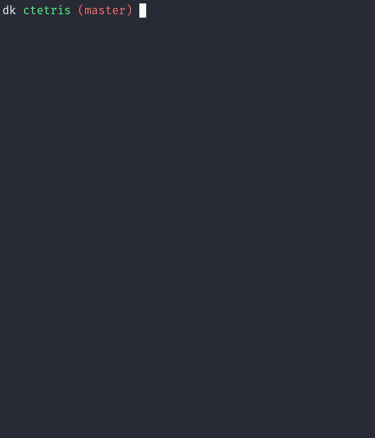

# ctetris

Yet another classic [tetris](https://en.wikipedia.org/wiki/Tetris) clone.
Dead simple, no bells and whistles, made out of boredom.



## Dependencies

- `cmake` and `make` for building
- `ncurses` for terminal stuff
- [ncge](https://github.com/kopiecki/ncge) git submodule

## Bulding

Tested only on GNU/Linux.

Update submodule:
```console
git submodule update --init
```

Release build:
```console
make
```

Debug build:
```console
make debug=y
```

## Running

```console
make run
```
## Configuration

Game is mostly configured by constants in `app/src/config.h`. You can change
some stuff there and recompile the program to see results.
